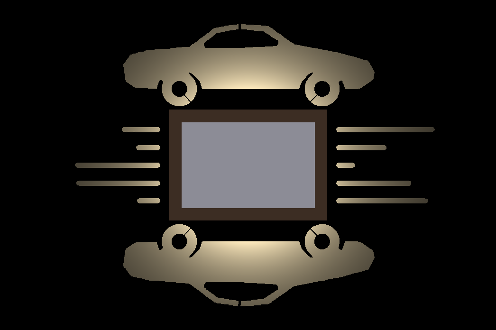

# ImageProjector – shadow-projecting picture frame

`projector_frame.py` generates printable STL files for a wall-hung picture
frame with a light inside. The four deep side walls are **stencils**: your
image is cut out of them as continuous shapes. An LED in the middle of the
frame shines through them and projects the image onto the wall **around**
the frame.

```
        wall (z = 0)
        │   ┌──────── bezel (front frame + picture window)
        │   │┌─────── picture
        │   ││┌────── backer plate with LED post
        │ ┌─┴┴┴─┐
        │ │  ▼  │  ◄─ LED points toward the wall, at light_z
 light ◄┼─▒     ▒─┼► side panels: stencils cut along the light rays
 on wall│ │     │
        │ └─────┘  ◄─ back plate: keyhole hangers, alignment lip, cable exit
```

## Car design (ready to print)



`examples/car_frame.py` draws an original sports-car silhouette
(`docs/car_image.png`). It projects the car above the frame, its mirror
reflection below, and speed lines to both sides.
`docs/raytrace_car.png` shows the same projection, ray-traced through the
actual STL geometry. The ready-made STLs in `stl/car/` are for a landscape
15 × 10 cm photo, a 60 mm deep frame, and the light 48 mm from the wall.

```bash
python3 examples/car_frame.py -o out_car                  # rebuild
python3 examples/car_frame.py -o out_car --preview-only   # preview only (fast)
```

**Your own car:** pass a high-contrast picture (white car on black) to
`projector_frame.py`. Keep the car out of the middle of the image, because
the frame covers that part. Details far from the frame are squeezed into a
thin strip of the panels, so keep the important parts close to the frame.

## How it works

1. Every point on a side panel is traced: *LED → point → wall*. If the ray
   lands on a bright part of the image, that point is cut open. The open
   areas become smooth outlines (no dots or pixels).
2. The cut edges are tilted along the light rays through the panel's
   thickness, so the light passes the full shape even at steep angles.
3. Dark areas fully enclosed by bright ones (a wheel hub, a window) would
   fall out of a stencil. Each one gets a thin **bridge** to the panel,
   taking the shortest route. It shows as a thin dark line in the
   projection.
4. Plastic strips thinner than `--min-web` and gaps narrower than
   `--min-gap` are removed so everything prints.

Brightness falls off with distance from the frame, so the image is brightest
next to the frame. There are thin dark lines along the diagonals where two
panels meet at a corner.

## Usage

```bash
pip install -r requirements.txt

python3 projector_frame.py --pattern sunburst -o out      # built-in: sunburst, stars, rings, waves
python3 projector_frame.py my_image.png -o out            # bright = light on the wall
python3 projector_frame.py logo.png --invert -o out       # dark = light
python3 projector_frame.py my_image.png --preview-only -o out
```

Output in `out/` (each part is already in its print orientation):

| file | what | print |
|---|---|---|
| `wall_top.stl`, `wall_bottom.stl` | full-width stencil panels | flat, outside face down |
| `wall_left.stl`, `wall_right.stl` | panels that fit between them | flat, outside face down |
| `back.stl` | back plate: keyholes, alignment lip, cable hole | back side down |
| `backer.stl` | opaque plate behind the photo with the LED post | flat, post up |
| `bezel.stl` | front frame with the picture window | face down |
| `assembly.stl` | everything assembled, for viewing only | – |
| `preview.png` | simulated light on the wall | |
| `target.png` | your image as mapped onto the wall | |

Main parameters (all in mm; `--help` lists everything):

| parameter | default | meaning |
|---|---|---|
| `--picture-w/-h` | 100 × 150 | photo size = box footprint |
| `--depth` | 60 | how far the frame sticks out from the wall |
| `--light-z` | 48 | height of the light above the wall |
| `--wall-t` | 1.6 | panel thickness |
| `--max-magnification` | 3.5 | how far out the image reaches (× frame size) |
| `--threshold` | 0.5 | image brightness that counts as "light" |
| `--fit` | cover | `cover`, `contain` or `stretch` the image over the lit area |
| `--invert` | off | dark parts of the image become light |
| `--bridge-w` | 0.9 | width of the bridges holding islands |
| `--min-web` / `--min-gap` | 0.8 / 0.5 | smallest printable plastic / opening |
| `--fit-clearance` | 0.25 | bezel press-fit gap; adjust for your printer |

## Building it

**Printing**
- Print the panels, back and backer in an **opaque, dark** filament. Light
  filaments glow and wash out the image. The bezel can be any colour.
- Panels print flat with no supports. The cut edges are slightly slanted
  (they follow the light), so the inside edge overhangs a little over a few
  layers. That's fine at normal settings.

**Light**
- Use a small, point-like, wide-angle LED: a bare 5 mm LED, or a 1–3 W LED
  on a small board. The smaller the emitter, the sharper the edges.
- The LED sits in the pocket at the tip of the backer post, **pointing at the
  wall**. Its leads run along the slot in the post and the diagonal groove
  in the backer to the bottom-left corner. From there they go down the
  inside corner of the box, which stays dark anyway, through the notch in
  the lip and the hole in the back plate. A groove in the back face takes
  the cable out of the bottom edge.
- Use a resistor or constant-current driver suited to your LED.

**Assembly**
1. Stand the panels on the back plate around its lip: top and bottom run
   the full width, left and right fit between them. Glue the corners and
   bottom edges (CA glue), and seal the inside corners with black tape so no
   light leaks.
2. Fit the LED and run its wire down the bottom-left corner and out through
   the back.
3. Hang the box on one or two screws using the keyhole slots in the back.
   Lower it so the screw heads slide up into the slots.
4. Lay the backer on the panel rims with the LED post pointing at the wall.
   Put the photo on it and push the bezel over the front.

The effect is best in a dark room.
