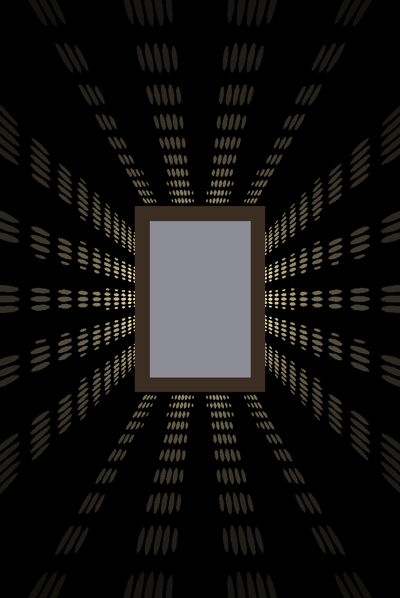

# ImageProjector – shadow-projecting picture frame

`projector_frame.py` generates printable STL files for a wall-hung picture frame
with a light inside. The frame's deep side walls are perforated, and light
from an LED in the centre shines through the holes onto the wall **around**
the frame, drawing an image there.

```
        wall (z = 0)
        │   ┌──────── bezel (front frame + picture window)
        │   │┌─────── picture
        │   ││┌────── backer plate with LED post
        │ ┌─┴┴┴─┐
        │ │  ▼  │  ◄─ LED points toward the wall, at light_z
        │ │  ·  │
 light ◄┼─o  ·  o─┼► side walls with holes, each cut along its own light ray
 on wall│ │     │
        │ └─────┘  ◄─ back plate with keyhole hangers + cable exit
```



*Simulated projection of the built-in `sunburst` pattern (`docs/preview_sunburst.png`).
The target image as mapped on the wall is shown in `docs/target_sunburst.png`.*

## How it works

1. A regular grid of cells is laid on the inside of the four side walls.
2. For each cell the script traces the ray *LED → cell → wall* and works out
   where it lands on the wall.
3. It samples your image at that point. Bright areas get holes, sized by
   brightness (`halftone`) or all the same size (`threshold`).
4. Each hole is cut as a prism **along its own ray**, so light passes through
   cleanly even at steep angles.

Dots further from the frame land bigger and dimmer, so the image fades
outwards. `--max-magnification` limits how far out the projection goes.
The centre of your image falls behind the frame and is not visible, so put
the interesting parts of the image towards its edges.

## Usage

```bash
pip install -r requirements.txt

# built-in pattern (sunburst | stars | rings | waves)
python3 projector_frame.py --pattern sunburst -o out

# your own image (bright = light on the wall)
python3 projector_frame.py my_image.png -o out
python3 projector_frame.py silhouette.png --invert --mode threshold -o out

# quick iteration: only preview.png / target.png, no STL
python3 projector_frame.py my_image.png --preview-only -o out

# a 13 x 18 cm photo, deeper frame
python3 projector_frame.py my_image.png --picture-w 130 --picture-h 180 --depth 65 --light-z 50
```

Output in `out/`:

| file           | what                                                        |
|----------------|-------------------------------------------------------------|
| `body.stl`     | back plate + perforated walls (print back-side down)        |
| `backer.stl`   | opaque plate behind the photo with the LED post (print flat, post up) |
| `bezel.stl`    | front frame with the picture window (print face down)       |
| `assembly.stl` | everything assembled, for viewing only                      |
| `preview.png`  | simulated light pattern on the wall                         |
| `target.png`   | your image as mapped onto the wall, for comparison          |

Run `python3 projector_frame.py --help` for every parameter (all in mm).
The most useful ones:

| parameter | default | meaning |
|---|---|---|
| `--picture-w/-h` | 100 × 150 | photo size = body footprint |
| `--depth` | 55 | how far the frame sticks out from the wall |
| `--light-z` | 42 | height of the light above the wall |
| `--pitch` | 2.6 | hole grid spacing (smaller = finer image, more fragile) |
| `--hole-min/-max` | 0.9 / 1.8 | hole size range |
| `--max-magnification` | 4 | how far out the projection reaches (×frame size) |
| `--mode` | halftone | `halftone` (size ∝ brightness) or `threshold` |
| `--fit` | cover | how the image fills the projection area: `cover`, `contain`, `stretch` |
| `--invert` | off | dark parts of the image become light |
| `--hole-shape` | circle | `circle`, `square` or `diamond` (diamond prints without bridging) |
| `--fit-clearance` | 0.25 | gap for the bezel's press fit; adjust for your printer |
| `--keyhole-spacing` | 0.5 | keyhole spacing as a fraction of the width; 0 = one central keyhole |

## Building it

**Printing**
- Print the body and backer in an **opaque, dark** filament. Light filaments
  glow through and wash out the projection. The bezel can be any colour.
- Body: back side down, no supports. Holes in the vertical walls are small
  enough to bridge; use `--hole-shape diamond` if your printer struggles.
- Backer: front face down, LED post up. Bezel: face down.

**Light**
- A small, point-like, wide-angle LED gives the sharpest image. A bare 5 mm
  LED, or a 1–3 W LED on a small board, both work. The bigger the
  emitting area, the blurrier the dots.
- The LED sits in the pocket at the tip of the backer post, **pointing at the
  wall**. Its leads run along the slot in the post and the groove in the
  backer, down the inside of the bottom wall (no holes there, see
  `--cable-gap`), and out through the hole in the back plate. A groove in the
  back face lets the cable leave the bottom edge flush with the wall.
- Use a resistor or a constant-current driver suited to your LED, e.g. a
  USB 5 V supply with the right series resistor.

**Assembly**
1. Hang the body on one or two screws using the keyhole slots. Lower it so the
   screw heads slide up into the slots.
2. Fit the LED and wire it through the back plate.
3. Lay the backer on the wall rims with the LED post pointing at the wall.
4. Lay the photo on the backer, then push the bezel over the front of the body.

Dark rooms give the best effect. A thin spot of no light at the bottom centre
is expected: no holes are cut where the cable runs.
